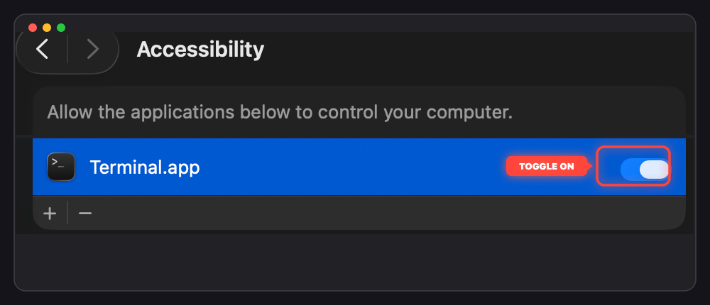

# 🪤 vibe-trap

> **macOS AFK Anti-Tamper & Jumpscare Utility**  
> *Keeping your MacBook screen awake, watching for unauthorized hands, and springing the ultimate trap.*

Built for the **[DEV Hacktoberfest 2026 Week 4 Challenge: Ghost in the Machine](https://dev.to/challenges/hacktoberfest-week4-2026-10-26)**.

---

## ⚡ Overview

When you're **vibe coding** with autonomous agents, long builds, downloads, and model generations mean you always run `caffeinate` to keep your MacBook awake while stepping away. But an unattended, awake laptop invites snooping coworkers or friends to touch your trackpad or browse your terminal history.

`vibe-trap` is a lightweight macOS AFK security trap that:
1. Keeps your MacBook screen awake using macOS `caffeinate`.
2. Listens for global system-wide input events (mouse and keyboard).
3. If an unauthorized person touches the mouse (any click) or types an incorrect key, it immediately launches a borderless, topmost, fullscreen jumpscare/meme window and blasts an eerie audio payload using native `afplay`.
4. It engages persistent kiosk lockout: loops audio at full volume, swallows controls, and locks macOS immediately if bypass is attempted.
5. If the laptop's rightful owner types the secret password (default: `vibetrap`), the trap **silently disarms** and exits safely.

---

## 🚀 Instant Run via `npx`

Zero setup, no Python environment, and no manual dependency installation required. Just run:

```bash
caffeinate -d npx vibe-trap
```

*(Or simply `npx vibe-trap`)*

---

## 🔐 macOS Permissions Setup

Because `vibe-trap` monitors global input events across macOS (even when running in the background while other applications are in focus), macOS requires two privacy permissions:

### 1. Accessibility
1. Open **System Settings** (` > System Settings...`).
2. Navigate to **Privacy & Security > Accessibility**.
3. Toggle **ON** your terminal application (e.g. **Terminal**, **iTerm2**, **Ghostty**, or **VS Code**).

<p align="center">
  
</p>

### 2. Input Monitoring
1. In **Privacy & Security**, scroll down to **Input Monitoring**.
2. Toggle **ON** your terminal application.

> [!NOTE]
> If run without permissions, `vibe-trap` prints a reminder notice. If macOS prompts you with an access dialog, click **"Open System Settings"** and enable the toggle.

---

## 🏃 Usage & How It Works

### Arming the Trap
Execute with `caffeinate -d` to keep your MacBook display awake while armed:

```bash
caffeinate -d npx vibe-trap
```

> [!TIP]
> **Keep Awake with Lid Closed (Clamshell Mode):**  
> By default, closing your MacBook lid puts macOS to sleep immediately. To keep background processes running even with the lid shut:
> ```bash
> # Prevent sleep when closing lid:
> sudo pmset -a disablesleep 1
> 
> # Restore default sleep behavior afterwards:
> sudo pmset -a disablesleep 0
> ```

### Disarming the Trap
When you return to your computer, simply type the secret password on your keyboard:
```text
vibetrap
```
The trap silently checks each keystroke prefix. Once the complete password is typed:
```text
[✓] PASSWORD VERIFIED ('vibetrap')! Vibe Trap disarmed.
[✓] Welcome back. Exiting safely.
```
The trap disarms and cleanly terminates without triggering any alarms or locking your screen.

---

## 💥 The Payload ("The Vibe Check")

If an intruder touches your laptop:
- **Mouse Click:** ANY mouse click (left, right, scroll-wheel click) triggers the trap immediately.
- **Wrong Keystroke:** Any key that deviates from the password sequence (e.g. typing `a`, `admin`, or pressing `Space`, `Enter`, `Shift`, `Backspace`) triggers the trap immediately.

When triggered, `vibe-trap` engages **Persistent Kiosk Lockout**:
1. **Continuous Looping Audio:** Blasts the jumpscare audio continuously at full volume until disarmed.
2. **Kiosk Screen Takeover:** Instantly renders a borderless, fullscreen window forced above the Dock, Menu Bar, and all applications (`.screenSaver` level) across all desktop spaces.
3. **Control Lockout:** Hides the mouse cursor and swallows all mouse clicks/shortcuts, preventing intruders from switching apps or accessing macOS controls.
4. **Invisible Disarm:** Type the secret password (`vibetrap`) blindly anywhere on the keyboard. A continuous sliding-window validator detects the sequence, immediately kills the audio, closes the window, and restores normal desktop access.
5. **Anti-Tamper Bypass Defense:** Any attempt to interrupt or kill the process (`Ctrl+C`, `Ctrl+\`, `Ctrl+D`, `SIGINT`, `SIGTERM`, `SIGHUP`) is caught instantly and triggers immediate workstation lock down (`SACLockScreenImmediate()` + `pmset displaysleepnow`).
6. **Fallback / Auto-Lock:** If no image file is found, it renders high-visibility emergency warning text. An optional `--timeout <ms>` flag is also available if you prefer auto-sleeping the screen after a set duration.

---

## 🎨 Asset Pairing & Customization

`vibe-trap` dynamically pairs and randomizes payload assets found in the `assets/` folder:

```text
assets/
├── scream.webp & scream.mp3 # Ghostface with knife + piercing scream
├── smile.webp  & smile.mp3  # Creepy smiling face + eerie echoing laughter
└── zombie.jpeg & zombie.mp3 # Hallway crawler ghoul + jumpscare roar
```

Whenever triggered, it picks a random matching image and audio pair from `assets/`. You can drop any custom meme or horror pair (`.png`, `.jpg`, `.webp`, `.wav`, `.mp3`) into `assets/`!

### Command-Line Options

| Flag | Description | Default |
|------|-------------|---------|
| `--password`, `-p` | Set a custom disarm password | `vibetrap` (or `$VIBE_TRAP_PASSWORD`) |
| `--timeout`, `-t` | Optional auto-lock timeout in milliseconds | Persistent until disarmed |
| `--image`, `-i` | Override with a specific image file | Auto / Assets |
| `--audio`, `-a` | Override with a specific audio file | Auto / Assets |
| `--assets-dir` | Custom directory containing assets | `assets` |
| `--trigger-on-move` | Also trigger on mouse movement (in addition to clicks) | Disabled |
| `--dry-run` | Test mode: triggers payload but skips screen sleep lock | Disabled |

#### Examples:

**Safe Test Mode (Dry Run - No Screen Sleep):**
```bash
npx vibe-trap --dry-run
```

**Custom Password:**
```bash
caffeinate -d npx vibe-trap --password "opensesame"
```

**Custom Jumpscare:**
```bash
caffeinate -d npx vibe-trap --image "assets/ghost.png" --audio "assets/ghost.wav"
```

---

## 🛠️ Architecture & Under the Hood

`vibe-trap` utilizes a high-performance **Hybrid npm + Native Swift Architecture**:
- **Node.js Wrapper (`bin/cli.js`):** Provides instant, zero-install execution via `npx vibe-trap`, verifying macOS compatibility and relaying system signals.
- **Native macOS Binary (`bin/vibe_trap`):** Ultra-lightweight (170 KB) native binary compiled from Swift ([`src/main.swift`](src/main.swift)). It leverages macOS `AppKit` (borderless fullscreen topmost window) and Quartz `CGEvent` taps + raw terminal `stdin` streams, starting in under 10ms with zero runtime dependencies.

### Local Development & Building

If you want to run or rebuild from source:

```bash
# Clone the repository
git clone https://github.com/ntsd/vibe-trap.git
cd vibe-trap

# Recompile native Swift binary
npm run build:bin

# Test CLI execution
npm test
```

---

## 🧪 Testing

To test the trap safely without locking your screen:

```bash
# Safe dry-run test
npx . --dry-run
```

- **Test Disarming:** Type `vibetrap` on your keyboard. The script silently disarms and exits.
- **Test Trap:** Touch the mouse or type any incorrect letter (e.g. `a`). The jumpscare window and audio payload will fire for 3 seconds.

---

## 📄 License

Distributed under the **MIT License**. See [`LICENSE`](LICENSE) for details.
